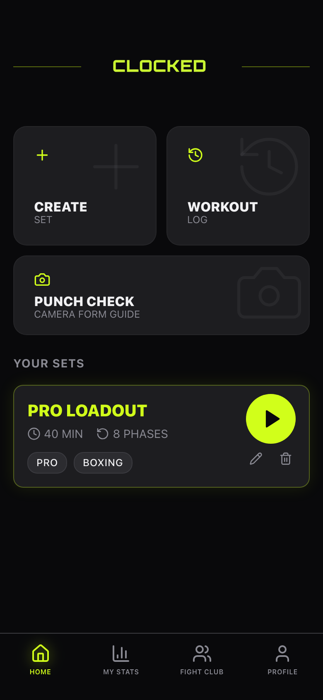
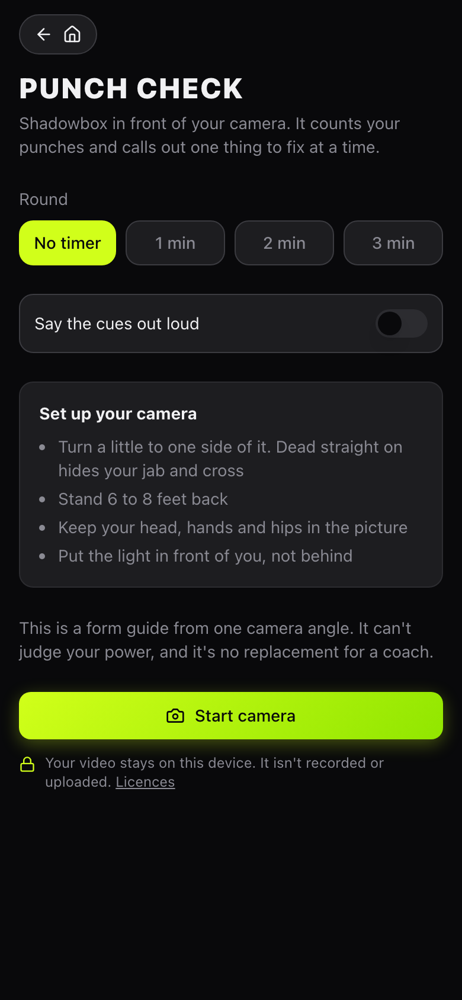
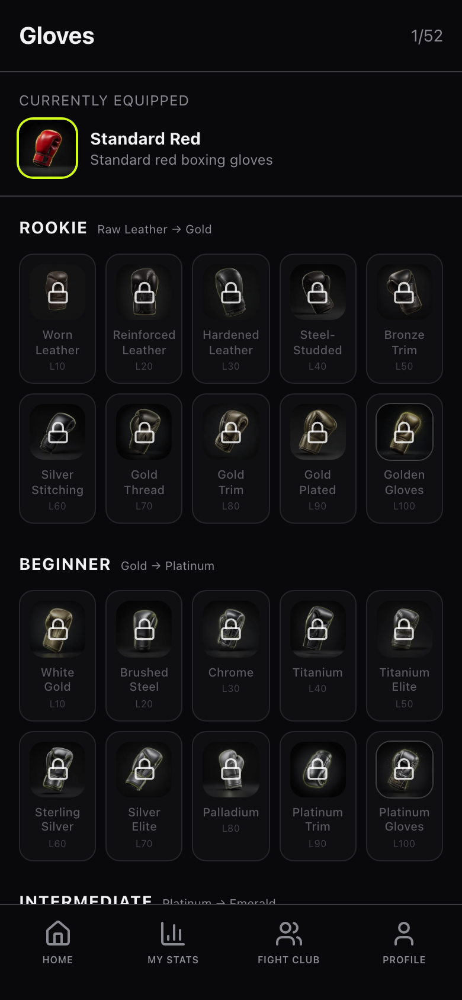

# How Clocked got built

My words are quoted as I wrote or said them, typos fixed, nothing else. Commit hashes are from this repo. "Private note" means a dated chat or call record I keep offline. Times from 2026-11-01 are Gulf time.

## 1. The short version

Clocked started on January 18, 2026 as a question about beginner boxing drills and, minutes later, a multi-phase workout clock called Clombo. Two days later it was called Clocked, and Lovable was writing the code while I tested it by shadowboxing downstairs.

In February I added XP and it hooked me. The first XP math was vibes. It broke the day I measured a real workout (666 XP against curves built for 1,154), so I threw the estimates out and, with Claude, calculated every combo in every tier. February alone took 909 commits, 654 of them in three days.

A move to Replit and a mobile path followed and never shipped. The last Lovable commit landed May 21. On November 1 the app got a guest mode, a security pass and a camera form guide called Punch Check, and it left Lovable for good. It's now a clone developed only in Claude Code, and readers bring their own Supabase and AI key. Then the backend ran on real hosted Supabase, and rewards stopped paying out for a 5-second workout.

The original design documents are in [docs/history/](docs/history/).

## 2. Origin, in my words

Why it exists (call recording, April 13, 2026):

> "You have to buy like $1,500 worth of hardware. Like you need to buy like a custom heavy bag with sensors on it and all this stuff. And it just wasn't built for the shadow boxing community."

How it got tested:

> "I was literally upstairs. I'd code it. I'd run downstairs. I'd do a round and I'd test it. And one day I decided to add a gamification system to it."

> "And the dopamine of leveling up started hitting me so hard."

The first ask to an AI (private note, January 18):

> "I want to make an app that basically is a workout clock. Workouts have multiple phases, sometimes different time increments for different parts of it, but these can happen in cycles and sets, and I want to basically make a multi-clock system that follows my sets. I'll call it 'Clombo' like combo clock."

The premise (vision notes, undated):

> "All you need to train with Clocked is shadow boxing. No gloves. No bag. No gym. No experience."

On the math (private note, February 16):

> "The process of me doing math for the first time in years trying to build this XP system."

## 3. Timeline

| Date (2026) | What happened | Evidence |
|---|---|---|
| Jan 18 | Drills question, then the Clombo clock framework written for Lovable | Private notes |
| Jan 20 | "Call it Clocked now." First Lovable commits, 123 that day: onboarding, combo builder, timer fixes | `e11a486`, `852ae20`, `15e89fa` |
| Jan 21 | Avatars, stats, countdown voice | `2859e16`, `f3d3f7e` |
| Feb 2 to 3 | XP components, then the double-spend loop | `6bbf765`, `04b43e8` |
| Feb 5 to 6 | User data isolated, user search, wall-clock timer, haptics and sounds | `b077638`, `ebb17cd`, `9e752c1`, `f19cdd6` |
| Feb 12 | Biggest day: 308 commits. Admin portal, parser overhaul, speed bag drills, exercise library | `948b9b6`, `2c87f61`, `2717305`, `af98ffe` |
| Feb 12 | I find out a competitor, PunchLab, exists | Private note |
| Feb 13 | 226 commits. Championship rounds, prestige, badge UI, XP test suites | `0d723ab`, `ffee2b0`, `f090985`, `96cd1cc` |
| Feb 14 | Apple sign-in, workout ratings, presets reordered | `eae1a6c`, `feee6e9`, `3aa50ac` |
| Feb | XP Curves Origin Story written up | [The PDF](docs/history/xp-curves-origin-story.pdf) |
| Feb 18 to 20 | AI builder agent specced, then the Google/AI edge function | Private note, `60944af` |
| Feb 25 | KOI Coach renamed AI Coach, full test suite, gloves on profile. Same day, the move to Replit | `252052b`, `1e22c22`, `72e2f24`, private note |
| Mar 12 | Mobile version handed to another AI build tool | Private note |
| Apr 5 to 6 | Launch to-do list written. Workout editor click and drag fixes | Private note, `6a62334`, `ab20106` |
| Apr 13 | Preset names fixed. I say "about 3,500 plus different tests" on a call | `f549d28`, call recording |
| May 21 | "Fixed 6 security findings", logo scaled up. Last Lovable commit | `bd3f86d`, `3cf00f5` |
| Nov 1 | Email-link-only sign-in, guest mode, audit fixes, nav bug, totals bug, new icons, Capacitor bump, MIT | `f501bd1`, `49700e3`, `3daadfe` to `cd25c1f`, `e95ebd5` |
| Nov 1 | Leaves Lovable: a clone developed only in Claude Code, with readers bringing their own Supabase and AI key | `56a97f3`, `445547b`, `071202e`, `05bea90` |
| Nov 1 | Punch Check, a fix after my first live try, a recording mode, the camera inside workouts, then tuning against that recording and quieter cues | `52f83d7`, `e1a9d2b`, `20879ec`, `af5e13f`, `bbf6da9`, `471b0fa` |
| Nov 1 | Migrations run on a new project, Data API grants made explicit | `f5d72d9`, `341f160` |
| Nov 1 | Production audit cleared, on react-router 7 | `aa2f45b`, `a81be2c` |
| Nov 1 | The backend run for real with `npm run test:stack`. Lint to zero, wired into CI | `04a9c31`, `78f9b06` |
| Nov 1 | Punch Check on phones, in WebKit and Firefox, and in long sessions | `329ca89` |
| Nov 1 | Real art for every glove and badge | `e0711d4`, `a27f2f8` |
| Nov 1 | Live training and coach tools labeled coming soon | `0d60eca`, `7e7edb9` |
| Nov 1 | Guest walk through the whole app, and its fixes | `221e222`, `ccbbae8`, `a1b5777` |
| Nov 1 | Rewards gated by what was actually trained | `cc5113c`, `54d53ef`, `9dda0c8` |
| Nov 1 | `SETUP.md` corrected from a run on real hosted Supabase | `8793b55`, `e37dfa2` |

History shape: 1,086 commits by Lovable's bot from January 20 to May 21, then my commits on November 1, made by directing Claude Code. Lovable's by month: January 151, February 909, April 20, May 5.

## 4. Round by round

### Round 1: the clock (January)
- **Built:** a workout clock with phases, combos, a builder and onboarding.
- **Tested:** me, downstairs, one round at a time.
- **Broke:** timer races and UI drift. The history has "Reverted to commit" over and over on day one, and `15e89fa` fixes the timer race. Later, one timer layout got "fixed" six times. `timer_layout_final_fix.md` lists every failed attempt and ends in a one-line change.
- **Fixed:** wall-clock timer (`9e752c1`).
- **Wanted next:** a reason to keep going. That became XP.

### Round 2: vibes-based XP (early February)
- **Built:** 100 XP a level, then "I meant 1,000 XP", then Pokémon-style stagger plus prestige multipliers.
- **Tested:** in the app, with me leveling up.
- **Broke:** XP double-spend loop (`04b43e8`). Worse, the curves were calibrated to 1,154 XP from a 59-minute workout that had been scrapped. The real session came out at 666 XP, 43% less. "The entire system was broken."
- **Fixed:** three options were on the table: inflate the rates, lower the thresholds or accept slower progress. I refused to inflate, because a jab is a jab. The curves moved instead.
- **Wanted next:** numbers that come from the workouts, not from me.

### Round 3: real math (mid February)
- **Built:** a Python calculator that walked every segment of every tier's loadout. Session XP came out at 679.8, 829.8, 1,096.6, 1,706.3 and 2,291.0. Then a two-constraint solver with scipy's `fsolve`, and later a power curve, `cost(n) = A × n^B`.
- **Tested:** side-by-side curve visualizations, and test suites generated from the math.
- **Broke:** the Level 500 idea. Six-plus curve fits failed, because any continuous curve meant about 1,700 more sessions at Pro.
- **Fixed:** cut it. Level 100 is the cap, and badges carry what comes after.
- **Wanted next:** an app that could build these workouts from plain words.

### Round 4: the AI builder and the parser (February 12 to 20)
- **Built:** natural language to timer workout, with a multi-phase parser, speed bag drills, supersets (renamed megasets) and equipment-aware loadouts. A model behind an edge function, and an on-device parser in case it's not there.
- **Tested:** generated multi-round workouts, tier by tier. One Advanced loadout run logged 22 passing checks and 3 bugs (`Advanced_Loadout_Bug_Report.md`).
- **Broke:** parser edge cases and library state bleeding between blocks (`0531f61`, `b63589e`).
- **Fixed:** parsers got their own tests (`supersetParser`, `speedBagParser`, `shadowboxParser`, `conditioningParser`).
- **Wanted next:** a real phone app.

### Round 5: the first try at leaving Lovable (February 25 to March 12)
- **Built:** a Replit port and a separate mobile path, with Claude Code comparing the two codebases.
- **Tested:** me on the port, the same night.
- **Broke:** "when I moved to Replit I started having weird shit": XP not animating, and skipping four segments jumped me to level 4 (private note, February 26).
- **Fixed:** not to the point of shipping.
- **Wanted next:** I handed mobile to another tool and went back to polishing the web app in Lovable. No mobile release is on record.

### Round 6: last polish (April to May)
- **Built:** editor fixes, preset names, profile trigger, security fixes (`08867b8`, `f549d28`, `bd3f86d`).
- **Tested:** by hand.
- **Broke:** drag handles swallowing clicks (`90e460c`, `ab20106`).
- **Wanted next:** launch work from the April to-do: coach-made presets, testing with non-boxers, glove art.

### Round 7: opening it up (November 1)
- **Built:** guest mode that stores everything in the browser, email-link sign-in, Punch Check. Lovable is the true start of this codebase, but development moved here: it's a clone worked on only in Claude Code, and anyone who wants the backend brings their own Supabase and AI key.
- **Tested:** see section 6.
- **Broke, found in testing:**
  - The bottom nav covered modal submit buttons on phone and desktop. Fixed in `c1f3d14`.
  - Logging a session passed a local id, which zeroed an account's totals in a stubbed test: 12 workouts became 0. Real accounts may have been showing zeroed totals. Fixed in `327eb90`.
  - A coach test only passed on a UTC machine (`36d0550`).
  - `club_members` reads failed with infinite recursion. Fixed in `21efa69`.
  - Punch Check: on a real camera, jabs came in as 5 and crosses as 4 (uppercut numbers). A straight became the default, and hooks and uppercuts now have to prove themselves.
  - Punch Check again: my labeled recording scored 11 of 29 on held-out reps, and lead uppercuts were almost never seen. Most of it was the detector, not the thresholds. Real uppercuts come back up only to guard height, so they were being thrown out as hands returning. A hook's wind-up and the other hand's recoil counted as punches. After tuning it's 24 of 29 on that one recording: one person, one camera, one session. That's optimistic, since the fixes came from studying it.
  - A guest walk through the whole app found that saved presets had no phases and ran empty, the AI Coach's Generate Workout opened an empty builder, and the mic on the workout log typed a canned sentence instead of listening. Speed bag drills and double-end combos were saved but never shown, and the time buttons sat on the combo card on short phones and laptops.
- **Fixed:** the audit list below, and all of the above.
- **Wanted next:** to find out if any of the backend really works.

### Round 8: real backend, real rewards (November 1)
- **Built:** `npm run test:stack`, a throwaway local Supabase with a real `db push`, functions against a fake AI provider, and a real browser clicking the link in the mail catcher. Then a run on real hosted Supabase, and `SETUP.md` corrected from it.
- **Tested:** see section 6.
- **Broke:**
  - Every fresh `db push` stopped at migration 19 of 39, on a seeded admin that doesn't exist on a new project (`f5d72d9`).
  - On a new project every query failed with 42501, since Supabase stopped exposing new tables by default (`341f160`).
  - A new account's first workout got a 406 from hosted Supabase, and the live badge check sat on a timer that restarted every second, so it never fired (`54d53ef`).
  - A 5-second test workout earned 13 badges and 1,267 XP (`cc5113c`). Pressing -30 to the end of a run earned +10 XP with nothing trained, and a first 6-minute run earned 7 badges for +430 XP (`9dda0c8`).
  - The feed showed a fake LIVE stream with invented viewers (`0d60eca`).
- **Fixed:** all of those. Preparation time no longer counts as training, sessions earn credit only for the kinds of training they had, four in-workout badges have real conditions, and live training and coach tools now say they're coming soon. The level curve and the combo math stayed as they were.

## 5. Feature family tree

```
beginner drills question
└─ workout clock (Clombo)
   ├─ combo notation → combo builder → tier-gated combos
   ├─ timer engine → voice callouts, haptics → championship rounds
   ├─ workout logging → stats → streaks
   └─ testing it by punching
      └─ "add a gamification system"
         └─ XP → prestige → badges → glove unlocks → real art
            └─ 666 XP problem → granular calculator → solver → power curves
               └─ generated test fixtures (2,700+ tests)
   clock + notation + XP tiers
   └─ loadouts → AI builder → parser suite → coach engine
      └─ edge function quota + on-device fallback → guest AI builder
   no account for reviewers → guest mode → Punch Check works with no backend
   5-second workout, 13 badges → rewards that follow the clock
   leaving Lovable → Claude Code only → bring your own Supabase and AI key → SETUP.md
   "no bag, no hardware" premise + phone camera → Punch Check → form cues in the log
```

## 6. Test log

| When | What | Result | Where |
|---|---|---|---|
| Feb | Advanced loadout, by hand | 22 pass, 3 bugs | `Advanced_Loadout_Bug_Report.md` |
| Apr 13 | My claim, "about 3,500 plus" | Confirmed by today's 3,588 count | Call recording, run below |
| Nov 1, published tip `e95ebd5`, fresh clone | `npm ci`, build, tests | Pass, 3,588 tests | Run while writing this |
| Nov 1, local tip with Punch Check | Vitest | 3,716 pass in 16 files: `xpVerification` 2,015, `loadoutValidation` 809, `xpExtended` 692, `punchDetector` 105, `coachEngine` 28, `punchRound` 17, the rest smaller | Run while writing this |
| Nov 1 | Timezones | Suite passed in 10 zones before the last small commits, and Tokyo on the later tree | Audit report |
| Nov 1 | Migrations on throwaway Postgres with stubbed auth | All 39 replay, 62 of 62 behavior checks as anon, authenticated, service role | Audit report |
| Nov 1 | Guest pass against the old Lovable-hosted backend | One Supabase request, `GET /rest/v1/clubs`, no writes, no console errors | Audit report |
| Nov 1 | Manual log | Real click at 390x844 and 1440x900, survives reload | Audit report |
| Nov 1 | `npm audit --omit=dev` | 13, down from 21, 0 critical | Audit report |
| Nov 1 | Punch Check on one labeled real recording: me, orthodox, one camera, one session, 10 of each punch plus guard (`?record=1`, kept out of this repo). Labels are what the prompt asked for, since nobody checked what I actually threw. Reps were split odd and even, with limits set on odd only | Held-out even reps labeled what was asked: 11 of 29 (38%) before, **25 of 29 (86%)** after. Odd reps: 10 of 30 to 25 of 30. Extra punches on even reps: 11 to 3. False punches in guard: 0 before and after. Across both halves: jabs 6 of 9, crosses 10 of 10, lead hooks 6 of 10, rear hooks 9 of 10, lead uppercuts 10 of 10, rear uppercuts 9 of 10. The fixes themselves came from looking at the whole recording, so 86% is likely optimistic. One person, so **not a general accuracy number** | `npm run punch:confusion -- file --split`, `bbf6da9` |
| Nov 1 | Punch Check on a rendered mannequin through the real pose model, 12 punches, on `bbf6da9` | Straight on: 9 found, 8 labeled right, 0 extras (was 9, 8, 3). Turned +35°: 11, 8, 0 (was 10, 6, 3). Turned -35°: 7, 5, 1 (was 8, 4, 1). Not a person, so not an accuracy number | Test recordings, rescored |
| Nov 1 | Punch Check on two public-domain US Air Force clips (Wikimedia Commons, DVIDS 955484 and 953899), on `bbf6da9` | 10 and 1 punch events (were 23 and 6). No ground truth, so counts only. No false punches in the mostly-interview openings, and that's weak evidence | Test recordings |
| Nov 1 | Punch Check, my first live try | Jabs read as 5 and crosses as 4, which led to the first fix | Commit message |
| Nov 1 | Punch Check personal calibration, offline on my one recording. First 3 reps of each punch calibrate, the rest are scored. Nearest-match relabeling only, method fixed before the final run | Remaining reps: generic 37 of 41, calibrated 36 of 41, 0 false punches in guard for both. **No win, so it didn't ship.** The generic limits were tuned on me, so this test can't show what it would do for anyone else. On the mannequin, which the limits weren't tuned on, it moved 25 to 28, 21 to 32 and 16 to 20 of 42 across three camera angles. That's a hint, not a person | Offline runs, not in this repo |
| Nov 1, `bbf6da9` | Vitest | 3,763 pass in 21 files, 157 of them for Punch Check | Run while tuning |
| Nov 1, `471b0fa` | Punch Check form cues on my one recording. Nobody knows which reps had real faults, so the only check is an independent measure from the picture: is the other hand below its own shoulder? | Punches with a cue: 19 of 31 down to 9 of 31 on odd reps, 20 of 32 down to 11 of 31 on even. "Elbow in" went from 13 to 0, and "reach all the way" from 7 to 1. "Other hand" now agrees with the picture on 6 of 8 drops on odd reps and 8 of 8 on even, with 2 and 1 cues the picture didn't back up. That shows the cues are consistent, **not that they're right**, and none has been tested against a fault I threw on purpose | `npm run punch:confusion -- file --cues` |
| Nov 1, `471b0fa` | Punch Check straights thrown at the camera | Mannequin straight on, 10 of each: jabs 4 to 7, crosses 4 to 5. On my recording, reps labeled what was asked: odd 25 to 26 of 30, held-out even 25 to 24 of 29, so 50 of 59 either way. The lost one is a held-out jab, and I'd already looked at that half once, so read the 83% with that in mind. Jabs stay 6 of 9 and crosses 10 of 10. 0 false punches in guard. Still one person | Offline runs, not in this repo |
| Nov 1, `471b0fa` | Vitest | 3,777 pass in 22 files | Fresh clone |
| Nov 1, `329ca89` | Punch Check in Chromium, Firefox and WebKit at phone sizes and in landscape, on the production build, with a canvas standing in for the camera so the same frames reach the real model | 192 of 192. Testing it found the camera panel over the workout timer on phones under 700 px tall, and the Play button and combo card overrun in landscape. Both fixed. The same frames went in everywhere, so this shows it runs and says nothing about accuracy. Not a real phone, and WebKit on a Mac isn't iOS Safari | Test recordings |
| Nov 1 | A 30-minute live Quick Session in Chromium with the real model and a fake camera, one commit before `329ca89` | 52,995 frames, a steady 30 fps, 509 punches counted but not scored, no errors, flat page and listener counts. JS heap went from 7 to 27 MB, which traces to the model's own GL tables, not my code. It also showed the session clock running about 10% slow, now fixed and checked over 90 s | Test recordings |
| Nov 1, `329ca89` | Vitest, lint, build | 3,804 pass in 24 files. Lint and build clean | Fresh clone |
| Nov 1, `a1b5777` | Guest walk through onboarding, building and running all 7 segment types, manual logs, history, stats, badges, presets and clubs in Chromium at 320x568, 390x844 and 1440x900, on the production build | 0 console errors at the end. 26 browser tests added, covering each bug. Clubs only got their no-backend message, since they need an account. Firefox, WebKit and real phones were not part of this walk | Scripted browser run |
| Nov 1, `a1b5777` | Timer buttons against the combo card, 253 screen sizes from 320 to 1920 wide and 480 to 932 tall | 0 overlaps. The page scrolls only under 560 px tall | Same run |
| Nov 1 | Real hosted Supabase, from a local build | The 40 migrations at that point applied in order through SQL. Database tests 23 of 23, no-key function tests 12 of 12. `generate-workout` and `admin-users` deployed, with `generate-workout` proving its fallback when there's no key. A real emailed link signed in | `8793b55`, session notes |
| Nov 1, `9dda0c8` | CI: lint, typecheck, unit tests, build, then the real local backend | Green. 3,832 unit tests, 43 browser tests, 23 database tests, 46 function tests (34 with an AI key set up, 12 without), all against a fake AI provider | GitHub Actions |
| Nov 1, fresh clone of `9dda0c8` | `npm ci`, lint, typecheck, build, unit tests, `npm audit --omit=dev` | All pass. 3,832 tests in 28 files. Lint 0 problems. 0 vulnerabilities | Run while writing this |

Most of the big count is generated from the XP and loadout data. It proves the math and the loadouts. It says nothing about whether a workout feels good.

### Numbers that disagree, on purpose

| Source | Rookie total to L100 | Formula |
|---|---|---|
| Origin Story PDF, chapter 5 | 14,276 | `BASE + COEFF × n^1.15` |
| Origin Story PDF, chapter 7 | 30,000 | `A × n^B`, A 142.70, B 0.200 |
| XP System PDF | 63,470 | Linear, `220 + n × 8.8` |
| Shipped `src/lib/xpSystem.ts` | 30,000 | A 180.50, B 0.1376 |

The PDFs are design history, not current numbers. The code wins.

## 7. Roads not taken

- **Inflating XP rates** to save the old curves. A jab is a jab.
- **Level 500, then 200.** Hard resets, soft resets, flat phases, piecewise curves and exponent swaps all failed. Level 100 stayed.
- **The compressed first session** (L5 to L3). The curve went flat. The version with seven level-ups in 40 minutes won.
- **Sensors as the entry fee.** The whole point is that you don't need them.
- **Personal calibration for Punch Check, for now.** I had the idea: throw about 3 of each punch so it learns your body and camera. On my own recording it scored 36 of 41 against 37 of 41 without it, so it didn't earn a place. Most of what's left is punches it never sees, and relabeling can't fix those. A recording from a second person or a new camera angle would be the fair test.
- **Google, Apple and password sign-in.** All removed November 1. Email link only.
- **Loosening database rules for reviewers.** Guest data stays in the browser instead.
- **Staying on Lovable.** The clone moved to bring-your-own instead.

## 8. What it looks like

Home, Punch Check setup and the gloves, November 1, in guest mode on the live site:

<p>
  
  
  
</p>

Design documents from the build. They're design history, so their numbers differ from the shipped code, and the code wins:

- [XP Curves Origin Story](docs/history/xp-curves-origin-story.pdf), February 2026: how the progression system was built, broken and rebuilt.
- [XP System](docs/history/xp-system.pdf): the full XP and gamification design (63,470 here, 30,000 in `xpSystem.ts`).

## 9. My method

1. **Be the user, physically.** Change it, go do a round, come back with notes.
2. **Measure, then design.** If the numbers disagree with reality, the numbers move. Never inflate the input to save the model.
3. **Kill the requirement when the math keeps fighting you.** Six failed fits meant Level 500 was the bug.
4. **Turn your specs into tests.** The XP tables became thousands of generated checks.
5. **Write down what failed.** `timer_layout_final_fix.md` lists six wrong fixes so the seventh prompt can't repeat them.

## 10. What's next

- Punch Check's camera-position work and full Quick Session logging are next.
- Record more people with `?record=1`, build a confusion table, then do more with the form data.
- Run the AI builder with a real model and a real key.
- Coach-made presets, and testing with non-boxers.
- The coach marketplace, live streaming and a native app are placeholders I'm still finishing: live training and coach tools show as coming soon, and there's no native build yet.
- A potential partnership with a sensor company, and a potential growth strategy with pro fighters. Both are only potential. We aren't naming names for privacy reasons.
- Other training styles someday. The clock doesn't care if it's boxing.

## 11. Sources

- Commits: `git log` of `fidgetcoding/clocked-main`.
- Code: `src/lib/xpSystem.ts`, `src/lib/punch/`, `src/test/`, `tests/`, `supabase/migrations/`. Setup: `SETUP.md`.
- Private, kept by me: chat records dated January 18 to April 18, 2026. Call recording, April 13, 2026. `knowledge/clocked-todo.md`, `Advanced_Loadout_Bug_Report.md`, `timer_layout_final_fix.md`. Vision notes. XP PDFs above.
- Audit and test report, November 1, 2026 (session notes), plus test runs made while writing this.
